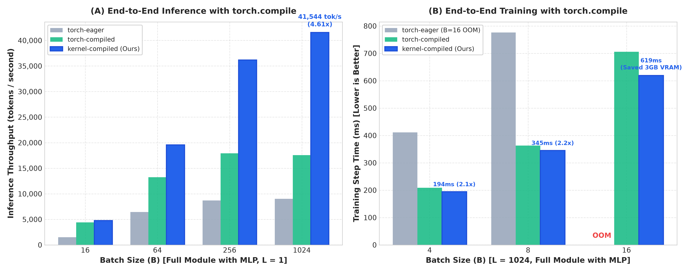
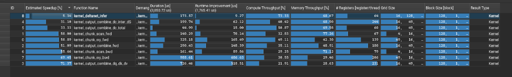

# DeltaNet v2: Fused Linear Attention CUDA Implementation for Turing GPUs

[](https://opensource.org/licenses/Apache-2.0)
[](https://pytorch.org/)
[](https://developer.nvidia.com/cuda-toolkit)
[-orange.svg)](https://developer.nvidia.com/cuda-gpus)

**DeltaNet v2** is a fast, hardware-optimized CUDA implementation of the linear attention mechanism with recurrent chunk-wise state updates (chunk WY representation) and Grouped Query Attention (GQA).

This project is based on NVIDIA's paper [**Gated DeltaNet v2** (arXiv:2605.22791)](https://arxiv.org/pdf/2605.22791), keeping the core recurrence architecture faithful to the original paper while incorporating Grouped Query Attention (GQA) for efficient scaling.

---

## 🎯 Motivation

Most existing open-source implementations of DeltaNet v2 and related linear attention variants focus almost exclusively on deep optimizations for high-end enterprise GPUs such as **NVIDIA A100 and H100+**. 

However, free and accessible cloud environments like **Google Colab and Kaggle** predominantly offer **NVIDIA Tesla T4** GPUs (Turing SM75), and many students, independent researchers, and developers work on consumer **RTX 20-series / 20 Super** hardware. 

This repository was created specifically to bridge that gap:
- **Tailored for Turing SM75**: Specifically engineered and tuned for the compute and shared memory constraints of Tesla T4 and RTX 20-series GPUs.
- **Accessible Experimentation**: Allows anyone to train, experiment with, and evaluate linear attention models on free Colab/Kaggle instances or accessible consumer cards without needing an A100 cluster.
- **Fused Kernel Pipelines**: Fuses multi-pass recurrences, normalizations, and epilogues into compact on-chip kernels to minimize global memory round-trips.

---

## ⚡ Highlights

- **Up to 7.75x Faster Inference**: Reaches over **1,229,000 tokens/s** peak single-step decode throughput on Tesla T4 (vs 158,688 tokens/s in PyTorch reference, and nearly 2x faster than official open-source baselines).
- **Up to 5.02x Faster Training**: Fused variable-length forward and backward recurrence with exact autograd support (22.96 ms step at $L=4096$ vs 115.32 ms in PyTorch reference and 63.25 ms in NVLabs).
- **2.0x Higher Batch Capacity**: Reduces peak activation and intermediate memory footprint, doubling max batch size before OOM.
- **`torch.compile` Ready**: Built-in PyTorch Dispatcher integration with fake tensor registrations for seamless `torch.compile` compatibility.
- **1-Command Setup**: Self-contained installation on Google Colab, Kaggle, and local GPU machines without external dependencies.

---

## 📊 Benchmark Results

All benchmarks were evaluated on an **NVIDIA Tesla T4 GPU (16 GB VRAM, SM75)** using **PyTorch 2.x**:

---

### Benchmark Suite 1: Full Layer with `torch.compile` (End-to-End Module)

> **Scope Note**: This benchmark evaluates the **complete end-to-end token-mixer block**, including all companion layers: input linear projections ($X \to q, k, v, b, w, \alpha, \gamma$), RMSNorm, gating network, output projection, and MLP / FFW.

#### 1. Autoregressive Inference (Single Decode Step, $L = 1$)
Evaluating generation throughput and latency across varying batch sizes ($d_{\text{model}} = 768$, $H_q = 8$, $H_{kv} = 4$, $d_k = 64$, $d_v = 64$):

| Batch Size | Mode | Latency (ms) | Throughput (tok/s) | Peak VRAM (GB) | Speedup vs Torch Eager |
|:---:|:---|:---:|:---:|:---:|:---:|
| **16** | torch-eager | 10.55 | 1,516 | 0.33 | 1.00x |
| 16 | torch-compiled | 3.63 | 4,405 | 0.32 | 2.90x |
| 16 | **kernel-compiled** | **3.36** | **4,769** | **0.32** | **3.14x** |
| **64** | torch-eager | 9.94 | 6,438 | 0.42 | 1.00x |
| 64 | torch-compiled | 4.83 | 13,258 | 0.38 | 2.06x |
| 64 | **kernel-compiled** | **3.27** | **19,570** | **0.36** | **3.04x** |
| **256** | torch-eager | 29.45 | 8,693 | 0.81 | 1.00x |
| 256 | torch-compiled | 14.29 | 17,917 | 0.62 | 2.06x |
| 256 | **kernel-compiled** | **7.08** | **36,184** | **0.56** | **4.16x** |
| **1024** | torch-eager | 113.56 | 9,017 | 2.34 | 1.00x |
| 1024 | torch-compiled | 58.30 | 17,565 | 1.59 | 1.95x |
| 1024 | **kernel-eager** | **26.11** | **39,215** | **1.36** | **4.35x** |
| 1024 | **kernel-compiled** | **24.65** | **41,544** | **1.36** | **4.61x** |

#### Maximum Batch Size & Peak Throughput (Decode)
| Mode | Max Batch Size (before OOM) | Peak Throughput (tok/s) | Time for 256 tokens (s) |
|:---|:---:|:---:|:---:|
| torch-eager | 6,656 | 9,152 | 186.2s |
| torch-compiled | 10,752 | 19,570 | 140.6s |
| kernel-eager | 12,288 | 40,706 | 77.3s |
| **kernel-compiled** | **13,312 (2.0x capacity)** | **42,258 (4.62x speedup)** | **80.6s** |

#### 2. Training (Forward + Backward Pass, $L = 1024$)
| Batch Size | Mode | Step Time (ms) | Training Throughput (tok/s) | Saved Activations VRAM |
|:---:|:---|:---:|:---:|:---:|
| **4** | torch-eager | 411.2 | 9,961 | 4.46 GB |
| 4 | torch-compiled | 209.0 | 19,600 | 2.36 GB |
| 4 | **kernel-compiled** | **194.3** | **21,083** | **1.62 GB** (2.76x less) |
| **8** | torch-eager | 776.0 | 10,555 | 8.71 GB |
| 8 | torch-compiled | 363.0 | 22,596 | 4.53 GB |
| 8 | **kernel-compiled** | **345.0** | **23,765** | **3.02 GB** (2.88x less) |
| **16** | torch-eager | *OOM* | - | - |
| 16 | torch-compiled | 706.0 | 23,198 | 8.86 GB |
| 16 | **kernel-compiled** | **619.0** | **26,459** | **5.85 GB** |



---

### Benchmark Suite 2: Pure Gated DeltaNet Token Mixer (vs Open-Source Baselines)

> **Scope Note**: This benchmark isolates and evaluates **strictly the recurrence token mixer kernels without companion layers (excluding MLP, SWA, and FFW)** to benchmark kernel compute performance fairly against open-source baselines:
> - **PyTorch Reference**: Pure un-fused PyTorch autograd baseline
> - **FLA GatedDeltaNet (v1)**: Flash Linear Attention chunkwise parallel implementation
> - **FLA GatedDeltaNet-2**: Flash Linear Attention v2 recurrence implementation
> - **NVLabs GatedDeltaNet-2**: NVIDIA Official Gated DeltaNet-2 recurrence implementation

#### 1. Autoregressive Inference (Single Decode Step, $L = 1$)
Evaluated across batch sizes $B \in [1, 16, 64, 256, 1024, 2048]$ ($d_{\text{model}} = 768$, $H_q = 8$, $H_{kv} = 8$, $d_k = 64$, $d_v = 64$):

| Batch Size (B) | Method / Implementation | Latency (ms) | Throughput (tok/s) | Peak VRAM (MB) | Speedup vs PyTorch |
|:---:|:---|:---:|:---:|:---:|:---:|
| **1** | PyTorch Reference (Unfused) | 0.980 | 1,020 | 27.4 | 1.00x |
| 1 | FLA GatedDeltaNet (v1) | 1.139 | 878 | 27.1 | 0.86x |
| 1 | FLA GatedDeltaNet-2 | 2.252 | 444 | 27.3 | 0.44x |
| 1 | NVLabs GatedDeltaNet-2 | 1.282 | 780 | 27.4 | 0.76x |
| 1 | **DeltaNet v2 (Ours)** | **0.281** | **3,557** | **27.3** | **3.49x** |
| **16** | PyTorch Reference (Unfused) | 1.756 | 9,111 | 36.9 | 1.00x |
| 16 | FLA GatedDeltaNet (v1) | 0.905 | 17,675 | 32.1 | 1.94x |
| 16 | FLA GatedDeltaNet-2 | 1.337 | 11,967 | 34.1 | 1.31x |
| 16 | NVLabs GatedDeltaNet-2 | 1.298 | 12,324 | 36.1 | 1.35x |
| 16 | **DeltaNet v2 (Ours)** | **0.598** | **26,760** | **34.0** | **2.94x** |
| **64** | PyTorch Reference (Unfused) | 1.361 | 47,027 | 71.2 | 1.00x |
| 64 | FLA GatedDeltaNet (v1) | 0.962 | 66,517 | 51.2 | 1.41x |
| 64 | FLA GatedDeltaNet-2 | 2.003 | 31,950 | 57.4 | 0.68x |
| 64 | NVLabs GatedDeltaNet-2 | 1.584 | 40,406 | 63.5 | 0.86x |
| 64 | **DeltaNet v2 (Ours)** | **0.414** | **154,628** | **59.3** | **3.29x** |
| **256** | PyTorch Reference (Unfused) | 2.207 | 116,011 | 208.5 | 1.00x |
| 256 | FLA GatedDeltaNet (v1) | 0.924 | 276,984 | 127.6 | 2.39x |
| 256 | FLA GatedDeltaNet-2 | 1.371 | 186,721 | 150.9 | 1.61x |
| 256 | NVLabs GatedDeltaNet-2 | 1.465 | 174,755 | 172.9 | 1.51x |
| 256 | **DeltaNet v2 (Ours)** | **0.437** | **585,870** | **156.4** | **5.05x** |
| **1024** | PyTorch Reference (Unfused) | 7.498 | 136,563 | 757.8 | 1.00x |
| 1024 | FLA GatedDeltaNet (v1) | 1.572 | 651,352 | 433.2 | 4.77x |
| 1024 | FLA GatedDeltaNet-2 | 1.752 | 584,317 | 525.2 | 4.28x |
| 1024 | NVLabs GatedDeltaNet-2 | 1.751 | 584,885 | 610.7 | 4.28x |
| 1024 | **DeltaNet v2 (Ours)** | **0.975** | **1,050,217** | **544.7** | **7.69x** |
| **2048** | PyTorch Reference (Unfused) | 12.906 | 158,688 | 1490.1 | 1.00x |
| 2048 | FLA GatedDeltaNet (v1) | 2.872 | 713,035 | 840.6 | 4.49x |
| 2048 | FLA GatedDeltaNet-2 | 3.138 | 652,713 | 1024.4 | 4.11x |
| 2048 | NVLabs GatedDeltaNet-2 | 3.139 | 652,358 | 1194.5 | 4.11x |
| 2048 | **DeltaNet v2 (Ours)** | **1.665** | **1,229,778** | **1062.4** | **7.75x** |

#### 2. Training Pass (Forward + Backward Step)
Evaluated across sequence lengths $L \in [512, 1024, 2048, 4096]$ with batch size $B = 4$ ($d_{\text{model}} = 768$, $H_q = 8$, $H_{kv} = 8$, $d_k = 64$, $d_v = 64$):

| SeqLen (L) | Tokens (B*L) | Method / Implementation | Fwd (ms) | Fwd+Bwd (ms) | Peak VRAM (MB) | Speedup vs PyTorch |
|:---:|:---:|:---|:---:|:---:|:---:|:---:|
| **512** | 2,048 | PyTorch Reference (Unfused) | 3.35 | 9.89 | 166.7 | 1.00x |
| 512 | 2,048 | FLA GatedDeltaNet (v1) | 5.08 | 11.65 | 95.4 | 0.85x |
| 512 | 2,048 | FLA GatedDeltaNet-2 | 2.46 | 8.27 | 157.5 | 1.20x |
| 512 | 2,048 | NVLabs GatedDeltaNet-2 | 2.51 | 8.36 | 164.3 | 1.18x |
| 512 | 2,048 | **DeltaNet v2 (Ours)** | **1.28** | **3.63** | **104.3** | **2.72x** |
| **1024** | 4,096 | PyTorch Reference (Unfused) | 4.74 | 17.97 | 309.8 | 1.00x |
| 1024 | 4,096 | FLA GatedDeltaNet (v1) | 9.26 | 20.95 | 153.4 | 0.86x |
| 1024 | 4,096 | FLA GatedDeltaNet-2 | 3.10 | 15.96 | 271.6 | 1.13x |
| 1024 | 4,096 | NVLabs GatedDeltaNet-2 | 3.13 | 15.97 | 275.6 | 1.13x |
| 1024 | 4,096 | **DeltaNet v2 (Ours)** | **1.62** | **5.53** | **154.6** | **3.25x** |
| **2048** | 8,192 | PyTorch Reference (Unfused) | 8.19 | 40.68 | 567.7 | 1.00x |
| 2048 | 8,192 | FLA GatedDeltaNet (v1) | 18.30 | 41.53 | 254.3 | 0.98x |
| 2048 | 8,192 | FLA GatedDeltaNet-2 | 6.79 | 31.73 | 492.2 | 1.28x |
| 2048 | 8,192 | NVLabs GatedDeltaNet-2 | 6.71 | 31.81 | 500.2 | 1.28x |
| 2048 | 8,192 | **DeltaNet v2 (Ours)** | **2.99** | **11.05** | **255.8** | **3.68x** |
| **4096** | 16,384 | PyTorch Reference (Unfused) | 16.77 | 115.32 | 1084.9 | 1.00x |
| 4096 | 16,384 | FLA GatedDeltaNet (v1) | 36.26 | 82.57 | 455.3 | 1.40x |
| 4096 | 16,384 | FLA GatedDeltaNet-2 | 14.15 | 63.31 | 933.7 | 1.82x |
| 4096 | 16,384 | NVLabs GatedDeltaNet-2 | 14.23 | 63.25 | 949.7 | 1.82x |
| 4096 | 16,384 | **DeltaNet v2 (Ours)** | **6.59** | **22.96** | **459.6** | **5.02x** |


---

### Hardware Profiling & Kernel Architectural Analysis (NVIDIA Nsight Compute)

The following profile captures low-level kernel execution on an **NVIDIA Tesla T4 (Turing SM75)** using **NVIDIA Nsight Compute (NCU)**:



#### Phân tích thiết kế kỹ thuật từ kết quả Nsight Compute:

1. **Chấp nhận đánh đổi Occupancy để tối đa hóa tính toán trên Register File**:
   - Thiết kế của các kernel DeltaNet v2 chủ động **đánh đổi giảm occupancy** (số block đồng thời trên mỗi Streaming Multiprocessor - SM) bằng cách cấp phát số lượng thanh ghi lớn (`# Registers` lên tới **180 – 244 registers/thread** trên các kernel chính như `kernel_output_combine_dc_inter_dS`, `kernel_chunk_wy_bwd`, `kernel_output_combine_dq_dk_dv`).
   - Việc giữ toàn bộ các ma trận trạng thái tái diễn $S$ và các giá trị trung gian trực tiếp trên tệp thanh ghi (Register File - RF) giúp ALU và Tensor Cores đạt hiệu suất tính toán tối đa, **triệt tiêu hoàn toàn việc phải ghi các ma trận trung gian ra bộ nhớ toàn cục (DRAM/HBM)** và giảm thiểu tối đa số lần đọc/ghi bộ nhớ giữa các bước tính.

2. **Lưu ý về chỉ số `Estimated Speedup [%]`**:
   - Cột `Estimated Speedup [%]` hiển thị trong Nsight Compute chỉ là con số **ước lượng lý thuyết dựa trên mô hình Roofline** (Roofline Model Bound), không phải là hiệu năng có thể tối ưu thêm được trong thực tế của kernel.

3. **Lý do một số kernel chưa đẩy tối đa Compute Throughput**:
   - Các kernel có compute throughput đo được ở mức trung bình (ví dụ `kernel_output_combine_dq_dk_dv` hay `kernel_chunk_scan_bwd`) là **chủ đích thiết kế kỹ thuật**: 
   - Các thao tác tính toán gradient đã được gộp lại (fused), chấp nhận độ trễ chờ nạp dữ liệu từ bộ nhớ và luân phiên nạp/ghi shared memory (SMEM ping-pong double buffering) nhằm tránh việc phải ghi lại các tensor gradient trung gian ra bộ nhớ toàn cục HBM/DRAM. Nhờ đó, tổng thời gian toàn bộ bước Forward + Backward giảm mạnh từ **115.32 ms xuống 22.96 ms** (nhanh hơn **5.02x**).

---

## 📋 Requirements & Supported GPUs

### 1. Supported GPUs (Turing SM75 with Tensor Cores)
The CUDA kernels are specifically engineered for **NVIDIA Turing SM75** hardware:
- **Cloud & Free-tier Environments**:
  - **NVIDIA Tesla T4** (Default free GPU tier on **Google Colab** and **Kaggle**)
- **Consumer Desktops & Laptops (GeForce RTX 20 Series)**:
  - GeForce RTX 2080 Ti
  - GeForce RTX 2080 Super / RTX 2080
  - GeForce RTX 2070 Super / RTX 2070
  - GeForce RTX 2060 Super / RTX 2060
  - GeForce RTX 20-Series Mobile / Max-Q GPUs
- **Professional & Workstation GPUs**:
  - Quadro RTX 4000, Quadro RTX 5000, Quadro RTX 6000, Quadro RTX 8000
- *Forward Compatibility*: Embedded `compute_75` PTX allows the binaries to be JIT-executed on newer GPUs (Ampere SM80/SM86, Ada SM89, Hopper SM90).

### 2. Software Requirements (Before Compilation)
Before building and compiling the extension, ensure your system provides:
- **Operating System**: Linux (Ubuntu 20.04/22.04+, Debian, CentOS/RHEL)
- **Python**: `>= 3.8` (including Python 3.10, 3.11, 3.12, 3.13)
- **PyTorch**: `>= 2.0.0` with CUDA support (e.g. `torch >= 2.1.0+cu121` or latest `torch >= 2.6.0`)
- **CUDA Toolkit**: `>= 11.8` or `12.x` (with `nvcc` compiler installed and accessible in `$PATH`)
- **C++ Host Compiler**: `gcc` / `g++ >= 10.0` supporting **C++20** (`-std=c++20`), with automatic fallback to **C++17** (`-std=c++17`)
- **Python Build Dependencies**:
  ```bash
  pip install -r requirements.txt
  # or: pip install torch setuptools wheel ninja
  ```
- **NVIDIA CUTLASS / CuTe**:
  - Requires **CUTLASS >= 3.0** (specifically the header-only `<cute/tensor.hpp>`).
  - **Automatic Handling**: `setup.py` automatically performs a shallow clone of CUTLASS (`git clone --depth 1 https://github.com/NVIDIA/cutlass.git`) into `./cutlass` during build if CUTLASS is not found on your system.

---

## 🚀 Quick Start

### 1. Installation

#### Option A: Instant Install from Prebuilt Wheel (Recommended for Google Colab / Linux x86_64):
```bash
git clone https://github.com/CBG6682/Varlen-Gated-DeltaNet.git
cd Varlen-Gated-DeltaNet
pip install wheels/*.whl
```

#### Option B: Standard Installation from Source:
```bash
git clone --recursive https://github.com/CBG6682/Varlen-Gated-DeltaNet.git
cd Varlen-Gated-DeltaNet
pip install ninja setuptools wheel einops
MAX_JOBS=2 pip install . --no-build-isolation
```

---

### 2. Usage Example

```python
import torch
from deltanet_v2 import DeltaBlock

device = "cuda" if torch.cuda.is_available() else "cpu"

# 1. Initialize DeltaBlock with independent key/value gating
model = DeltaBlock(
    d_model=768,
    num_q_heads=8,
    num_kv_heads=4,  # Supports GQA (num_q_heads % num_kv_heads == 0)
    d_k=64,
    d_v=64,
    chunk_size=64,
    hidden_dim=768 * 4,
).to(device=device, dtype=torch.float16)

# -------------------------------------------------------------
# Training (Variable-length Packed Sequences)
# -------------------------------------------------------------
model.train()

# 2 sequences of lengths [512, 1024] packed into total_L = 1536 tokens
total_L = 1536
x = torch.randn(total_L, 768, device=device, dtype=torch.float16, requires_grad=True)
cu_seqlens = torch.tensor([0, 512, 1536], dtype=torch.int32, device=device)

# Forward pass using fused CUDA kernel
out, final_states = model(x, cu_seqlens=cu_seqlens, use_kernel=True)

# Backward pass
loss = out.sum()
loss.backward()
print("Grad x shape:", x.grad.shape)  # torch.Size([1536, 768])

# -------------------------------------------------------------
# Autoregressive Token Generation (L = 1 decode step)
# -------------------------------------------------------------
model.eval()

batch_size = 64
next_token = torch.randn(batch_size, 1, 768, device=device, dtype=torch.float16)

# Initialize recurrent state: (B, num_kv_heads, d_v, d_k)
past_states = torch.zeros(batch_size, 4, 64, 64, device=device, dtype=torch.float16)

with torch.no_grad():
    y, past_states = model(next_token, past_states=past_states, use_kernel=True)

print("Decoded token shape:", y.shape)            # torch.Size([64, 1, 768])
print("Updated state shape:", past_states.shape)  # torch.Size([64, 4, 64, 64])
```

---

### 3. Accelerated with `torch.compile`

DeltaNet v2 kernels register fake/meta tensors with the PyTorch Dispatcher, enabling full graph capture under `torch.compile`:

```python
compiled_model = torch.compile(model)
out, states = compiled_model(x, cu_seqlens=cu_seqlens, use_kernel=True)
```

---

## 🔬 Running Benchmarks in Google Colab

Open [`demo.ipynb`](file:///demo.ipynb) in Google Colab (with automatic C++20 build and C++17 fallback) or run directly in bash:

```bash
# 1. Clone repository with dedicated third_party/cutlass submodule to /content/Deltanet
git clone --recursive https://github.com/CBG6682/Varlen-Gated-DeltaNet.git /content/Deltanet
cd /content/Deltanet

# 2. Fast install via prebuilt wheel or build from source
pip install ninja setuptools wheel einops
pip install wheels/*.whl || MAX_JOBS=2 pip install . --no-build-isolation

# 3. Install baselines
pip install git+https://github.com/sustcsonglin/flash-linear-attention.git --no-build-isolation
git clone --depth 1 https://github.com/NVlabs/GatedDeltaNet-2.git /content/gateddeltanet-2
echo "# Standalone" > /content/gateddeltanet-2/lit_gpt/__init__.py

# 4. Numerical Correctness Sanity Test (Kernel Varlen vs PyTorch Varlen Reference)
python /content/Deltanet/tests/test_correctness.py

# 5. Benchmark Single-Step Autoregressive Inference (L = 1)
python -u /content/Deltanet/tests/bench_inference.py --dim 768 --batches 1,16,64,256,1024,2048 --warmup 5 --iters 20

# 6. Benchmark Training Pass (Forward + Backward)
python -u /content/Deltanet/tests/bench_training.py --dim 768 --batch-size 4 --seq-lens 512,1024,2048,4096 --warmup 3 --iters 10
```

---

## 📂 Project Structure

```
Deltanet/
├── include/
│   ├── deltanet_common.cuh       # Math utilities, activations, warp reduction
│   └── deltanet_ops.cuh          # Kernel declarations & host coordinators
├── src/
│   ├── binding.cpp               # PyTorch dispatcher & Python C-extension
│   ├── chunk_wy_fwd.cu           # Chunk WY forward kernel
│   ├── chunk_wy_bwd.cu           # Chunk WY backward kernel
│   ├── chunk_scan_fwd.cu         # Recurrence scan forward kernel
│   ├── chunk_scan_bwd.cu         # Recurrence scan backward kernel
│   ├── output_combine_fwd.cu     # Output combination forward kernel
│   ├── output_combine_bwd.cu     # Output combination backward kernels
│   ├── deltanet.cu               # Forward & backward pipeline coordinators
│   └── deltanet_infer.cu         # Fast single-step (L = 1) inference kernel
├── deltanet_v2/
│   ├── __init__.py               # Package exports
│   ├── ops.py                    # Op dispatcher, fake tensor registrations, autograd
│   └── model.py                  # Full DeltaBlock PyTorch module
├── tests/
│   ├── utils.py                  # CUDA event timers, VRAM tracking, baseline loaders
│   ├── bench_inference.py        # Autoregressive decode step (L = 1) benchmark
│   ├── bench_training.py         # Forward + Backward training pass benchmark
│   └── test_correctness.py       # Numerical consistency verification vs PyTorch
├── assets/
│   ├── benchmark_compiled_e2e.png            # End-to-end benchmark chart
│   ├── benchmark_opensource_baselines.png    # Open-source baselines comparison chart
│   └── ncu_kernel_summary.png                # Nsight Compute hardware profiling summary
├── third_party/
│   └── cutlass/                  # Dedicated NVIDIA CUTLASS / CuTe submodule (>= 3.0)
├── wheels/                       # Pre-compiled standalone .whl distributions
├── demo.ipynb                    # Colab / Kaggle runner notebook (/content)
├── setup.py                      # Build script with auto-CUTLASS discovery
├── pyproject.toml                # PEP 517/518 build specification
├── requirements.txt              # Build and runtime Python dependencies
├── LICENSE                       # Apache 2.0 License
└── README.md
```

---

## 📜 License

This project is licensed under the **Apache License 2.0**. You are free to use, modify, and distribute this software for personal, academic, and commercial purposes. See [LICENSE](LICENSE) for details.
