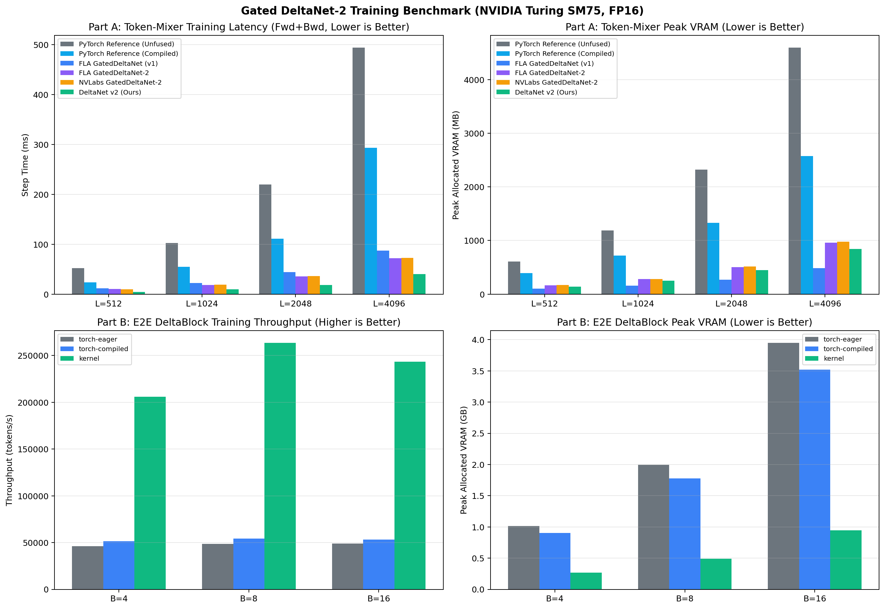
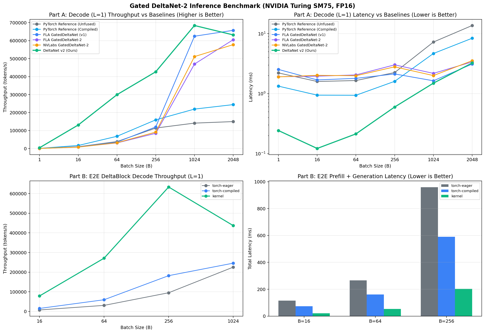

<h1 align="center">
  
</h1>

<p align="center"><em>Fused Variable-Length Gated DeltaNet v2 &amp; Single-Step Decode CUDA/CuTe Kernels for NVIDIA Turing (SM75)</em></p>

<p align="center">
  
  
  
  
</p>

<p align="center"><em>Built with the tools and technologies:</em></p>

<p align="center">
  
  
  
  
  
</p>

<div align="center">

| **12.35x** | **13.06x** | **13.5% / 52.7% ↓** | **9.85** |
|:---:|:---:|:---:|:---:|
| Training speedup vs PyTorch (`L=4096`, `1.81x` vs NVLabs) | Decode speedup vs PyTorch (`B=16`, `16.56x` vs NVLabs) | Peak VRAM vs NVLabs GDN-2 (Train `L=4096` / Decode `B=1024`) | Peak FP16 TFLOP/s on Tesla T4 |

</div>

<details>
<summary><b>Table of Contents</b></summary>

- [Overview](#overview)
- [Benchmarks](#benchmarks)
- [Benchmark Analysis & Kernel Limitations](#benchmark-analysis--kernel-limitations)
- [Installation](#installation)
- [Quick start](#quick-start)
- [Running tests, benchmarks & profiling](#running-tests-benchmarks--profiling)
- [Project structure](#project-structure)
- [License](#license)

</details>

---

## Overview

`deltanet_v2` provides fused variable-length training/prefill and single-step (`L = 1`) autoregressive decode CUDA/CuTe kernels for [**Gated DeltaNet v2** (arXiv:2605.22791)](https://arxiv.org/pdf/2605.22791), tuned specifically for **NVIDIA Turing (`SM75`)** GPUs (e.g. Tesla T4, RTX 20 series) with native **PyTorch Autograd**, **GQA**, **`ShortConv1D`**, and **`torch.compile`** support.

- **Fused training & prefill pipeline:** Combines `ShortConv1D` + activation/L2-norm + gating/`beta_guard`, chunkwise WY factorization, inter-chunk FP32 state scan, and output norm/gating across packed varlen sequences (`cu_seqlens`), cutting DRAM round-trips and saved backward activations.
- **Single-kernel autoregressive decode (`L = 1`):** Executes conv state shift, normalization, gates, in-place FP32 recurrent state update, and output RMSNorm/gating in one CUDA kernel launch to minimize launch latency at small/medium batches and reduce peak VRAM at large batches.
- **PyTorch & packaging integration:** Registers `TORCH_LIBRARY` / `FakeTensor` ops and ships a pre-built `.whl` in [`wheels/`](wheels/) alongside source-build support.

---

## Benchmarks

> [!NOTE]
> All benchmarks below were measured on **NVIDIA Tesla T4 (16 GB, `SM75`, 40 SMs)** in FP16 (`torch.float16`, PyTorch `2.14.1+cu130`, CUDA `13.0`, Python `3.13`) via [benchmark/demo.ipynb](benchmark/demo.ipynb). All 3 correctness suites in [tests/test_correctness.py](tests/test_correctness.py) (varlen Fwd/Bwd & chunkwise vs token-by-token recurrence, decode `L=1`, end-to-end `DeltaBlock` handoff + CUDA Graphs + API guards) passed prior to benchmarking. Per-kernel Nsight Compute reports (`*.ncu-rep`) are also generated by [benchmark/demo.ipynb](benchmark/demo.ipynb) inside `benchmark/`.

### Training benchmark

<p align="center">
  
</p>

**Part A — Pure token mixer vs open-source baselines** (`B = 4`, `d_model = 768`, `H_q = 8`, `H_kv = 8`, `d_k = d_v = 64`, `chunk_size = 64`, `conv = True`):

| SeqLen (`L`) | Tokens (`B*L`) | Method | Fwd (ms) ↓ | Fwd+Bwd (ms) ↓ | TFLOP/s ↑ | Peak VRAM (MB) ↓ | Speedup ↑ |
| ---: | ---: | --- | ---: | ---: | ---: | ---: | ---: |
| 512 | 2,048 | PyTorch Reference (Unfused) | 20.96 | 52.32 | 0.81 | 605.7 | 1.00x |
| 512 | 2,048 | PyTorch Reference (Compiled) | 13.44 | 23.76 | 1.77 | 391.4 | 2.20x |
| 512 | 2,048 | **DeltaNet v2 (Ours)** | **1.96** | **4.28** | **9.85** | 139.3 | **12.22x** |
| 512 | 2,048 | FLA GatedDeltaNet (v1) | 4.82 | 11.62 | 3.63 | **101.0** | 4.50x |
| 512 | 2,048 | FLA GatedDeltaNet-2 | 3.27 | 10.50 | 4.01 | 162.2 | 4.98x |
| 512 | 2,048 | NVLabs GatedDeltaNet-2 | 3.32 | 9.94 | 4.24 | 169.0 | 5.26x |
| 1024 | 4,096 | PyTorch Reference (Unfused) | 31.63 | 102.26 | 0.82 | 1186.4 | 1.00x |
| 1024 | 4,096 | PyTorch Reference (Compiled) | 24.13 | 54.52 | 1.55 | 717.1 | 1.88x |
| 1024 | 4,096 | **DeltaNet v2 (Ours)** | **2.70** | **9.42** | **8.95** | 249.7 | **10.86x** |
| 1024 | 4,096 | FLA GatedDeltaNet (v1) | 9.69 | 22.55 | 3.74 | **160.5** | 4.54x |
| 1024 | 4,096 | FLA GatedDeltaNet-2 | 3.58 | 18.43 | 4.57 | 278.6 | 5.55x |
| 1024 | 4,096 | NVLabs GatedDeltaNet-2 | 3.41 | 19.05 | 4.42 | 282.6 | 5.37x |
| 2048 | 8,192 | PyTorch Reference (Unfused) | 63.74 | 219.90 | 0.77 | 2322.9 | 1.00x |
| 2048 | 8,192 | PyTorch Reference (Compiled) | 40.95 | 111.03 | 1.52 | 1330.8 | 1.98x |
| 2048 | 8,192 | **DeltaNet v2 (Ours)** | **5.62** | **18.55** | **9.09** | 447.3 | **11.85x** |
| 2048 | 8,192 | FLA GatedDeltaNet (v1) | 19.08 | 43.94 | 3.84 | **267.5** | 5.00x |
| 2048 | 8,192 | FLA GatedDeltaNet-2 | 7.35 | 35.90 | 4.70 | 505.4 | 6.13x |
| 2048 | 8,192 | NVLabs GatedDeltaNet-2 | 7.73 | 36.52 | 4.62 | 513.4 | 6.02x |
| 4096 | 16,384 | PyTorch Reference (Unfused) | 129.98 | 494.11 | 0.68 | 4595.9 | 1.00x |
| 4096 | 16,384 | PyTorch Reference (Compiled) | 78.18 | 293.40 | 1.15 | 2576.6 | 1.68x |
| 4096 | 16,384 | **DeltaNet v2 (Ours)** | **13.20** | **40.02** | **8.42** | 844.1 | **12.35x** |
| 4096 | 16,384 | FLA GatedDeltaNet (v1) | 38.13 | 87.48 | 3.85 | **482.3** | 5.65x |
| 4096 | 16,384 | FLA GatedDeltaNet-2 | 16.05 | 71.97 | 4.68 | 959.6 | 6.87x |
| 4096 | 16,384 | NVLabs GatedDeltaNet-2 | 16.46 | 72.54 | 4.65 | 975.6 | 6.81x |

**Part B — End-to-end `DeltaBlock` training with SwiGLU MLP** (`d_model = 768`, `hidden_dim = 3072`, `H_q = 8`, `H_kv = 4`, `L = 1024`):

| Batch (`B`) | Mode | Step (ms) ↓ | Throughput (tok/s) ↑ | Peak VRAM (GB) ↓ | Speedup ↑ |
| ---: | --- | ---: | ---: | ---: | ---: |
| 4 | torch-eager | 88.8 | 46,152 | 1.01 | 1.00x |
| 4 | torch-compiled | 79.4 | 51,559 | 0.91 | 1.12x |
| 4 | **kernel** | **19.9** | **205,824** | **0.27** | **4.46x** |
| 8 | torch-eager | 168.6 | 48,601 | 1.99 | 1.00x |
| 8 | torch-compiled | 151.2 | 54,178 | 1.78 | 1.11x |
| 8 | **kernel** | **31.1** | **263,606** | **0.49** | **5.42x** |
| 16 | torch-eager | 334.5 | 48,987 | 3.95 | 1.00x |
| 16 | torch-compiled | 307.3 | 53,316 | 3.52 | 1.09x |
| 16 | **kernel** | **67.3** | **243,297** | **0.95** | **4.97x** |

### Inference benchmark

<p align="center">
  
</p>

**Part A — Single-step decode (`L = 1`) pure token mixer vs open-source baselines** (`d_model = 768`, `H_q = 8`, `H_kv = 8`, `conv = True`):

| Batch (`B`) | Method | Latency (ms) ↓ | Throughput (tok/s) ↑ | Memory BW (GB/s) ↑ | Peak VRAM (MB) ↓ | Speedup ↑ |
| ---: | --- | ---: | ---: | ---: | ---: | ---: |
| 1 | PyTorch Reference (Unfused) | 2.216 | 451 | 3.0 | 28.1 | 1.00x |
| 1 | PyTorch Reference (Compiled) | 1.334 | 749 | 4.9 | 27.9 | 1.66x |
| 1 | **DeltaNet v2 (Ours)** | **0.243** | **4,116** | **27.1** | **27.7** | **9.12x** |
| 1 | FLA GatedDeltaNet (v1) | 2.534 | 395 | 2.6 | 28.0 | 0.87x |
| 1 | FLA GatedDeltaNet-2 | 1.915 | 522 | 3.4 | 28.0 | 1.16x |
| 1 | NVLabs GatedDeltaNet-2 | 1.905 | 525 | 3.5 | 28.0 | 1.16x |
| 16 | PyTorch Reference (Unfused) | 1.596 | 10,027 | 6.8 | 37.3 | 1.00x |
| 16 | PyTorch Reference (Compiled) | 0.945 | 16,931 | 11.5 | 32.5 | 1.69x |
| 16 | **DeltaNet v2 (Ours)** | **0.122** | **130,926** | **88.7** | **30.0** | **13.06x** |
| 16 | FLA GatedDeltaNet (v1) | 1.694 | 9,446 | 6.4 | 34.6 | 0.94x |
| 16 | FLA GatedDeltaNet-2 | 1.955 | 8,185 | 5.5 | 34.7 | 0.82x |
| 16 | NVLabs GatedDeltaNet-2 | 2.020 | 7,920 | 5.4 | 34.7 | 0.79x |
| 64 | PyTorch Reference (Unfused) | 1.655 | 38,666 | 14.8 | 65.5 | 1.00x |
| 64 | PyTorch Reference (Compiled) | 0.940 | 68,064 | 26.0 | 49.0 | 1.76x |
| 64 | **DeltaNet v2 (Ours)** | **0.214** | **299,495** | **114.5** | **38.9** | **7.75x** |
| 64 | FLA GatedDeltaNet (v1) | 1.800 | 35,558 | 13.6 | 53.2 | 0.92x |
| 64 | FLA GatedDeltaNet-2 | 2.052 | 31,183 | 11.9 | 53.5 | 0.81x |
| 64 | NVLabs GatedDeltaNet-2 | 1.989 | 32,182 | 12.3 | 53.5 | 0.83x |
| 256 | PyTorch Reference (Unfused) | 2.248 | 113,892 | 35.1 | 180.1 | 1.00x |
| 256 | PyTorch Reference (Compiled) | 1.605 | 159,484 | 49.2 | 113.8 | 1.40x |
| 256 | **DeltaNet v2 (Ours)** | **0.600** | **426,926** | **131.6** | **73.0** | **3.75x** |
| 256 | FLA GatedDeltaNet (v1) | 2.132 | 120,071 | 37.0 | 130.2 | 1.05x |
| 256 | FLA GatedDeltaNet-2 | 3.022 | 84,714 | 26.1 | 131.2 | 0.74x |
| 256 | NVLabs GatedDeltaNet-2 | 2.800 | 91,429 | 28.2 | 131.2 | 0.80x |
| 1024 | PyTorch Reference (Unfused) | 7.245 | 141,333 | 41.0 | 636.1 | 1.00x |
| 1024 | PyTorch Reference (Compiled) | 4.668 | 219,345 | 63.6 | 370.1 | 1.55x |
| 1024 | **DeltaNet v2 (Ours)** | **1.496** | **684,284** | **198.3** | **209.1** | **4.84x** |
| 1024 | FLA GatedDeltaNet (v1) | 1.639 | 624,688 | 181.0 | 438.1 | 4.42x |
| 1024 | FLA GatedDeltaNet-2 | 2.179 | 469,940 | 136.2 | 442.1 | 3.33x |
| 1024 | NVLabs GatedDeltaNet-2 | 2.002 | 511,383 | 148.2 | 442.1 | 3.62x |
| 2048 | PyTorch Reference (Unfused) | 13.671 | 149,808 | 43.0 | 1312.6 | 1.00x |
| 2048 | PyTorch Reference (Compiled) | 8.414 | 243,413 | 70.0 | 783.6 | 1.63x |
| 2048 | DeltaNet v2 (Ours) | 3.241 | 631,993 | 181.2 | **460.6** | 4.22x |
| 2048 | FLA GatedDeltaNet (v1) | **3.115** | **657,429** | **188.5** | 850.3 | **4.39x** |
| 2048 | FLA GatedDeltaNet-2 | 3.384 | 605,191 | 173.5 | 858.2 | 4.04x |
| 2048 | NVLabs GatedDeltaNet-2 | 3.544 | 577,855 | 165.7 | 858.2 | 3.86x |

**Part B — End-to-end `DeltaBlock` inference (`Prefill = 512`, `Gen = 32` steps)** (`d_model = 768`, `hidden_dim = 3072`, `H_q = 8`, `H_kv = 4`):

| Batch (`B`) | Mode | Decode `L=1` (ms) ↓ | Throughput (tok/s) ↑ | E2E Prefill+Gen (ms) ↓ | Peak VRAM (MB) ↓ |
| ---: | --- | ---: | ---: | ---: | ---: |
| 16 | torch-eager | 2.099 | 7,621 | 115.04 | 799.1 |
| 16 | torch-compiled | 1.047 | 15,281 | 72.82 | 496.7 |
| 16 | **kernel** | **0.203** | **78,752** | **20.54** | **196.7** |
| 64 | torch-eager | 2.077 | 30,809 | 266.14 | 3118.5 |
| 64 | torch-compiled | 1.075 | 59,524 | 161.48 | 1909.6 |
| 64 | **kernel** | **0.236** | **271,126** | **52.83** | **709.6** |
| 256 | torch-eager | 2.692 | 95,082 | 958.52 | 12398.2 |
| 256 | torch-compiled | 1.406 | 182,102 | 590.90 | 7562.0 |
| 256 | **kernel** | **0.404** | **633,530** | **202.67** | **2762.2** |
| 1024 | torch-eager | 4.541 | 225,485 | — | 323.8 |
| 1024 | torch-compiled | 3.096 | 330,700 | — | 206.8 |
| 1024 | **kernel** | **2.343** | **436,985** | — | **117.1** |

---

## Benchmark Analysis & Kernel Limitations

### 1. Benchmark Interpretation

- **Training & Prefill (`1.80x–2.45x` faster than GDN-2 Triton baselines):** Chunkwise prefill and training convert sequential dependencies into dense intra-chunk matrix operations (`chunk_size = 64`). Because arithmetic intensity is high, executing fused Tensor Core GEMMs and keeping intermediate chunk tiles on-chip yields up to **9.85 TFLOP/s** (`40.02 ms` vs `71.97–72.54 ms` for FLA/NVLabs GDN-2 at `L = 4096`). Notice that `torch-compiled` on `DeltaBlock` Training Part B triggers a `torch._dynamo` `recompile_limit` warning inside the GQA reshape path of the PyTorch baseline, whereas the `kernel` path avoids that overhead completely.
- **Why Training Part A Peak VRAM is higher than `FLA GatedDeltaNet (v1)` (`844.1 MB` vs `482.3 MB` at `L = 4096`):** `FLA v1` implements the older **GDN-1** recurrence (scalar decay per head without vector `w`, channel-wise FP32 decay, `beta_guard`, or `o_gate`), so it inherently materializes fewer activations for backward. Compared fairly against **same-algorithm GDN-2** baselines (`FLA GatedDeltaNet-2` and `NVLabs GatedDeltaNet-2`), our kernel reduces Peak VRAM by **10.4%–17.6%** (`844.1 MB` vs `959.6–975.6 MB` at `L = 4096`) while running roughly twice as fast.
- **Decode (`L = 1`) scaling — launch-bound at small batches vs DRAM Roofline at large batches:**
  - At **`B = 1..256`**, single-step decode is dominated by kernel launch overhead and intermediate DRAM traffic (`1.56%` DRAM and `1.65%` SM throughput at `B = 1` in Nsight Compute). Fusing the entire recurrence step into a single kernel gives **3.75x–13.06x** speedup over PyTorch Unfused and **4.67x–16.56x** speedup over FLA/NVLabs GDN-2.
  - At **`B = 1024..2048`**, `L = 1` decode becomes strictly **memory-bandwidth bound**: each step both reads and writes the FP32 `past_states` matrix `(B, H_kv, 64, 64)` (`134 MB` read + `134 MB` write at `B = 1024`; `268 MB` read + `268 MB` write at `B = 2048` for `H_kv = 8`), saturating Tesla T4's practical DRAM bandwidth (**`181–208 GB/s`**, `63.2%` SOL DRAM throughput in NCU) while high register usage per thread (`123` regs, `49.3%` achieved occupancy) bounds concurrency. Because compute throughput is no longer the bottleneck at `B = 2048`, any well-tuned CUDA or Triton kernel converges to the same ~`3.1–3.5 ms` hardware memory wall. Even there, in-place state updates reduce decode **Peak VRAM by ~46%–53%** (`209.1 MB` vs `442.1 MB` at `B = 1024`; `460.6 MB` vs `858.2 MB` at `B = 2048`).
- **Scope of Inference Part B (`E2E Prefill+Gen`):** Part B benchmarks full `DeltaBlock` (token mixer + SwiGLU MLP) against `torch-eager` and `torch-compiled` only, and skips the `Prefill=512 + Gen=32` rollout at `B = 1024` (`—`) to prevent baseline OOM on 16 GB VRAM. Pure token-mixer prefill comparisons against `FLA` and `NVLabs` correspond to the `Fwd (ms)` column in Training Part A (`1.96–13.20 ms`, `1.22x–1.69x` faster than GDN-2 Triton baselines).

### 2. Known Kernel Constraints & Design Tradeoffs

- **Target architecture (`SM75+`):** Built natively for **NVIDIA Turing (`sm_75` + `compute_75` PTX)** Tensor Cores. Newer architectures (`SM80+`) can run via PTX JIT, but do not use Ampere/Hopper-specific hardware features (`cp.async`, `BF16` MMA, TMA).
- **Fixed kernel dimensions:** Requires `d_k == 64`, `d_v == 64`, `chunk_size == 64`, `conv_size == 4`, `num_q_heads % num_kv_heads == 0`, `d_model % 8 == 0`, and (`hidden_dim % 8 == 0` when MLP is enabled).
- **Precision & buffer alignment:** Model weights and sequence inputs/outputs must be **`torch.float16`**, while `A_log`, `dt_bias`, and recurrent `past_states` are **`torch.float32`**. Super-fused in-place decode (`L = 1`) requires contiguous, 16-byte-aligned `past_states` (`FP32`) and `conv_state` (`FP16`).
- **Internal `(H, L, D)` head-first layout:** Forward/backward kernels operate internally in `(H, L, D)` for coalesced per-head memory access and fixed `64`-element inner strides, fusing the `(L, H, D) <-> (H, L, D)` layout transpose into the boundary kernels rather than launching standalone transpose ops.
- **Default `final_conv_state` allocation in `DeltaBlock`:** `DeltaBlock.forward(..., use_kernel=True)` keeps `output_conv_state=True` so prefill can hand off convolution state directly to decode. In pure training runs that discard `final_conv_state`, this adds a small `(B, 3, D_qkv)` FP16 write; callers invoking the low-level [`apply_deltablock`](deltanet_v2/ops.py) op directly can pass `output_conv_state=False` to skip it.

---

## Installation

### Requirements

- **GPU:** NVIDIA Turing (`SM75`, e.g. Tesla T4, RTX 2060/2070/2080) or compatible CUDA GPU
- **Software:** Python `>= 3.13`, CUDA Toolkit `>= 11.8` (`12.x` / `13.0` supported), PyTorch `>= 2.0`, `setuptools >= 61.0`, `wheel`, `ninja`
- **CUTLASS:** Pinned as a submodule in `third_party/cutlass` (`setup.py` initializes `third_party/cutlass` or shallow-clones CUTLASS automatically if missing)

### Option 1: Reuse the pre-built wheel (`wheels/`)

A pre-compiled wheel is shipped in [`wheels/deltanet_v2-2.0.0-py3-none-any.whl`](wheels/deltanet_v2-2.0.0-py3-none-any.whl).

> [!IMPORTANT]
> Even though the filename uses a `py3-none-any.whl` tag, it bundles the compiled native binary `deltanet_v2/_C.cpython-313-x86_64-linux-gnu.so` built for **`x86_64` Linux**, **Python 3.13**, **PyTorch `2.14.1+cu130`**, **CUDA `13.0`**, and **`SM75`**. If your Python, PyTorch, or CUDA runtime differs, loading `_C` will fail cleanly—use [Option 2](#option-2-recompile-from-cuda-source) instead.

Install and verify the pre-built wheel:

```bash
pip install --force-reinstall --no-deps wheels/deltanet_v2-2.0.0-py3-none-any.whl
python -c "import torch, deltanet_v2; from deltanet_v2 import _C; print('Loaded:', _C.__file__)"
```

> **Note:** When running `pip install -e .` without `FORCE_REBUILD=1`, `setup.py` automatically extracts and reuses the `_C*.so` inside `wheels/*.whl` (or an existing `deltanet_v2/_C*.so`) instead of recompiling from CUDA source.

### Option 2: Recompile from CUDA source

Use this option if you modified `.cu`/`.cuh` files, need a wheel for another Python/PyTorch/CUDA environment, or want to target a different GPU compute capability.

```bash
git clone --recursive https://github.com/CBG6682/Varlen-Gated-DeltaNet.git
cd Varlen-Gated-DeltaNet
git submodule update --init --depth 1 third_party/cutlass
pip install -r requirements.txt
```

**Clean rebuild & editable install (bypasses cached `.so` / `wheels/*.whl`):**

```bash
rm -rf build dist deltanet_v2/_C*.so
FORCE_REBUILD=1 MAX_JOBS=2 pip install --no-deps --no-build-isolation -e .
```

**Rebuild the `.so` and repackage a fresh `.whl` into `wheels/`:**

```bash
rm -rf build dist deltanet_v2/_C*.so
FORCE_REBUILD=1 MAX_JOBS=2 python setup.py build_ext --inplace
rm -f wheels/*.whl
python -m pip wheel --no-deps --no-build-isolation -w wheels .
pip install --force-reinstall --no-deps wheels/deltanet_v2-2.0.0-py3-none-any.whl
```

> **Build tips:**
> - `setup.py` defaults to `MAX_JOBS=2` because CuTe template instantiation uses ~1.5–2.0 GB host RAM per NVCC worker (safe on 12 GB Colab/containers); raise `MAX_JOBS` on machines with ample RAM for faster builds.
> - By default `setup.py` compiles `-gencode=arch=compute_75,code=sm_75` plus `compute_75` PTX. Override with `TORCH_CUDA_ARCH_LIST="8.0;8.6"` (etc.) if desired (note that the kernels still rely on Turing-compatible MMA/layout definitions).
> - NVCC uses `-std=c++20` by default and automatically falls back to `-std=c++17` on failure.

---

## Quick start

### Packed varlen training / prefill (`DeltaBlock`)

```python
import torch
from deltanet_v2 import DeltaBlock

device = "cuda"
model = DeltaBlock(
    d_model=768,
    num_q_heads=8,
    num_kv_heads=4,
    d_k=64,
    d_v=64,
    chunk_size=64,
    hidden_dim=768 * 4,
).to(device=device, dtype=torch.float16)

# Packed batch of 2 sequences: lengths [512, 1024] -> total_L = 1536
cu_seqlens = torch.tensor([0, 512, 1536], dtype=torch.int32, device=device)
x = torch.randn(1536, 768, device=device, dtype=torch.float16, requires_grad=True)

out, final_states, final_conv_state = model(x, cu_seqlens=cu_seqlens, use_kernel=True)
out.sum().backward()
```

### Autoregressive decode (`L = 1`)

```python
model.eval()
batch_size = 64
d_qkv = (8 + 2 * 4) * 64  # (H_q + 2 * H_kv) * d_k

x_next = torch.randn(batch_size, 1, 768, device=device, dtype=torch.float16)
past_states = torch.zeros(batch_size, 4, 64, 64, device=device, dtype=torch.float32)
conv_state = torch.zeros(batch_size, 3, d_qkv, device=device, dtype=torch.float16)

with torch.no_grad():
    y, past_states, conv_state = model(
        x_next, past_states=past_states, conv_state=conv_state, use_kernel=True
    )
```

---

## Running tests, benchmarks & profiling

```bash
# 1. Numerical correctness (Varlen Fwd/Bwd, Chunkwise == Recurrence, Decode L=1, E2E Handoff, CUDAGraph)
python tests/test_correctness.py

# 2. Training benchmark (Token Mixer vs Baselines & E2E DeltaBlock; pass --skip-external for PyTorch-only)
python tests/bench_training.py --save-plot assets/training_benchmark.png

# 3. Inference benchmark (Decode L=1 & E2E Prefill+Gen; pass --skip-external for PyTorch-only)
python tests/bench_inference.py --gen-steps 32 --save-plot assets/inference_benchmark.png
```

For the full reproducible Colab/Kaggle pipeline—including wheel reuse/rebuild, correctness verification, fast & full benchmarks, and **NVIDIA Nsight Compute (`ncu`)** kernel profiling—see [benchmark/demo.ipynb](benchmark/demo.ipynb). All 16 generated `.ncu-rep` kernel reports in `benchmark/` (for forward, backward, and `kernel_deltanet_infer`) can be inspected with `ncu-ui` or `ncu --import benchmark/<kernel>.ncu-rep` (`*.ncu-rep` files are excluded from git via [.gitignore](.gitignore)).

---

## Project structure

```text
Varlen-Gated-DeltaNet/
├── include/                         # CUDA/CuTe headers (deltanet_common.cuh, deltanet_ops.cuh)
├── src/                             # Fused training, backward, block, decode kernels & PyTorch bindings
├── deltanet_v2/                     # Python package (ops.py, model.py)
├── tests/                           # Correctness & benchmark suites
├── benchmark/                       # End-to-end demo notebook (demo.ipynb) & local .ncu-rep profiles
├── assets/                          # Animated title SVG & benchmark plots
├── wheels/                          # Pre-built wheel (.whl)
├── setup.py
├── pyproject.toml
├── requirements.txt
└── LICENSE                          # Apache License 2.0
```

---

## License

This project is licensed under the **Apache License 2.0**. See [LICENSE](LICENSE) for details.
