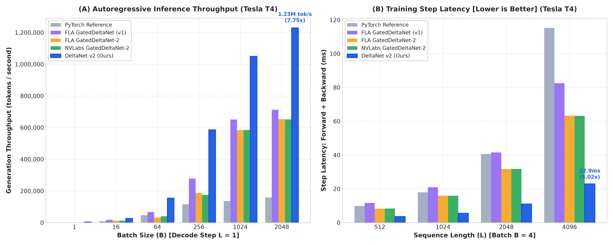

# Varlen-Gated-DeltaNet (`deltanet_v2`)

High-performance **Variable-Length Gated DeltaNet v2** (chunk-wise WY recurrence), **GQA Token Mixing**, and **Single-Step (`L = 1`) Autoregressive Decode** CUDA/CuTe library for **NVIDIA Turing (`SM75` — Tesla T4 / RTX 20 series)**, with native **PyTorch Autograd** and **`torch.compile` (TorchInductor)** support.

Based on NVIDIA's [**Gated DeltaNet v2** (arXiv:2605.22791)](https://arxiv.org/pdf/2605.22791), preserving the exact chunk-wise recurrence formulation while adding GQA and fused Turing kernels.

---

## Motivation

This project was built to help **students, researchers, and self-learners** train and run linear-attention models efficiently on accessible **Turing (`SM75`)** GPUs such as **Google Colab / Kaggle Tesla T4** and **RTX 20 series** cards:

- **Modern open-source kernels target Ampere+ (`SM80+`):** Most existing DeltaNet / linear-attention kernels are tuned for A100/H100 and hit shared-memory, register, or architecture bottlenecks on Turing `SM75`.
- **Unfused PyTorch baselines waste VRAM and launch overhead:** Pure PyTorch chunked recurrences materialize large intermediate tensors and cannot fuse intra-chunk attention, inter-chunk state scans, and normalization epilogues cleanly.
- **Ready-to-use `torch.compile` integration:** `deltanet_v2` registers `FakeTensor` metadata with the PyTorch Dispatcher (`TORCH_LIBRARY`), bundles CUTLASS `4.9.0` submodule compatibility, and supports 1-command source/wheel installation out of the box.

---

## Benchmarks (NVIDIA Tesla T4 — `SM75`)

> **Hardware Scope:** All benchmarks below were measured on **NVIDIA Tesla T4 (16 GB, `SM75`)** in FP16 (`torch.float16`). Other GPU architectures have not yet been evaluated.

### 1. Training Benchmark (`Fwd` & `Fwd+Bwd`)



#### Part A: Pure Token Mixer vs Open-Source Baselines (`B = 4`, `d_model = 768`, `H_q = 8, H_kv = 8, D = 64`)

| SeqLen | Tokens | PyTorch Eager (ms) | FLA v1 (ms) | FLA v2 (ms) | NVLabs v2 (ms) | DeltaNet v2 (Ours) | Speedup (vs PyTorch / NVLabs) | Peak VRAM (Ours / NVLabs) |
| ------ | ------ | ------------------ | ----------- | ----------- | -------------- | ------------------ | ----------------------------- | ------------------------- |
| **512** | 2,048 | 9.89 | 11.65 | 8.27 | 8.36 | **3.63 ms** | **2.72x / 2.30x** | **104.3** / 164.3 MB (-37%) |
| **1024** | 4,096 | 17.97 | 20.95 | 15.96 | 15.97 | **5.53 ms** | **3.25x / 2.89x** | **154.6** / 275.6 MB (-44%) |
| **2048** | 8,192 | 40.68 | 41.53 | 31.73 | 31.81 | **11.05 ms** | **3.68x / 2.88x** | **255.8** / 500.2 MB (-49%) |
| **4096** | 16,384 | 115.32 | 82.57 | 63.31 | 63.25 | **22.96 ms** | **5.02x / 2.75x** | **459.6** / 949.7 MB (-52%) |

#### Part B: End-to-End `DeltaBlock` (`L = 1024`, `H_q = 8, H_kv = 4`, `hidden_dim = 4 * d_model`) with `torch.compile`

| Batch | Torch Eager (ms / tok/s) | Torch+Comp (ms / tok/s) | Kernel+Comp (ms / tok/s) | Speedup vs Eager | Saved Activations (Base Comp / Ours) |
| ----- | ------------------------ | ----------------------- | ------------------------ | ---------------- | ------------------------------------ |
| **4** | 411.2 / 9,961 | 209.0 / 19,600 | **194.3 / 21,083** | **2.12x** | **1.62** / 2.36 GB (-31%) |
| **8** | 776.0 / 10,555 | 363.0 / 22,596 | **345.0 / 23,765** | **2.25x** | **3.02** / 4.53 GB (-33%) |
| **16** | *OOM* | 706.0 / 23,198 | **619.0 / 26,459** | - | **5.85** / 8.86 GB (-34%) |

---

### 2. Inference Benchmark (`L = 1` Decode & End-to-End `torch.compile`)


#### Part A: Pure Token-Mixer Decode (`L = 1`, `d_model = 768`, `H_q = 8, H_kv = 8, D = 64`)

| Batch | PyTorch Eager (ms) | FLA v1 (ms) | FLA v2 (ms) | NVLabs v2 (ms) | DeltaNet v2 (Ours) | Tok/s | Speedup (vs PyTorch / NVLabs) |
| ----- | ------------------ | ----------- | ----------- | -------------- | ------------------ | ----- | ----------------------------- |
| **1** | 0.980 | 1.139 | 2.252 | 1.282 | **0.281 ms** | 3,557 | **3.49x / 4.56x** |
| **16** | 1.756 | 0.905 | 1.337 | 1.298 | **0.598 ms** | 26,760 | **2.94x / 2.17x** |
| **64** | 1.361 | 0.962 | 2.003 | 1.584 | **0.414 ms** | 154,628 | **3.29x / 3.83x** |
| **256** | 2.207 | 0.924 | 1.371 | 1.465 | **0.437 ms** | 585,870 | **5.05x / 3.35x** |
| **1024** | 7.498 | 1.572 | 1.752 | 1.751 | **0.975 ms** | 1,050,217 | **7.69x / 1.80x** |
| **2048** | 12.906 | 2.872 | 3.138 | 3.139 | **1.665 ms** | 1,229,778 | **7.75x / 1.89x** |

#### Part B: End-to-End `DeltaBlock` Decode (`L = 1`, `H_q = 8, H_kv = 4`, `hidden_dim = 4 * d_model`) with `torch.compile`

| Batch | Torch Eager (ms / tok/s) | Torch+Comp (ms / tok/s) | Kernel+Comp (ms / tok/s) | Speedup vs Eager | Peak VRAM (Ours / Eager) |
| ----- | ------------------------ | ----------------------- | ------------------------ | ---------------- | ------------------------ |
| **16** | 10.55 / 1,516 | 3.63 / 4,405 | **3.36 / 4,769** | **3.14x** | **0.32** / 0.33 GB |
| **64** | 9.94 / 6,438 | 4.83 / 13,258 | **3.27 / 19,570** | **3.04x** | **0.36** / 0.42 GB |
| **256** | 29.45 / 8,693 | 14.29 / 17,917 | **7.08 / 36,184** | **4.16x** | **0.56** / 0.81 GB |
| **1024** | 113.56 / 9,017 | 58.30 / 17,565 | **24.65 / 41,544** | **4.61x** | **1.36** / 2.34 GB |

*Max Decode Batch Capacity before OOM:* **13,312** (`kernel-compiled`, **42,258 tok/s**) vs **10,752** (`torch-compiled`, 19,570 tok/s) vs **6,656** (`torch-eager`, 9,152 tok/s).

---

## Installation

### Requirements
- **GPU:** NVIDIA Turing (`SM75`, e.g., Tesla T4, RTX 2060/2070/2080) or compatible CUDA GPU
- **CUDA Toolkit >= 11.8** (`12.x` / `13.0` supported) + **PyTorch >= 2.0** + **Python 3.13**
- **CUTLASS >= 4.x:** Tracked in `third_party/cutlass` (`setup.py` initializes or shallow-clones CUTLASS automatically if missing)

### Option 1: Install Pre-built Wheel (Fastest)
If a matching `.whl` for your Python/PyTorch environment exists in `wheels/`:

```bash
pip install --no-deps wheels/*.whl
```

### Option 2: Build from Source
```bash
git clone --recursive https://github.com/CBG6682/Varlen-Gated-DeltaNet.git
cd Varlen-Gated-DeltaNet
pip install -r requirements.txt
pip install --no-deps --no-build-isolation -e .
```

To package a reusable `.whl` in `wheels/`:

```bash
python -m pip wheel --no-deps --no-build-isolation -w wheels .
```

---

## Quick Start

### 1. Packed Varlen Training (`DeltaBlock` + `torch.compile`)

```python
import torch
from deltanet_v2 import DeltaBlock

device = "cuda"
model = DeltaBlock(
    d_model=768,
    num_q_heads=8,
    num_kv_heads=4,
    d_k=64,
    d_v=64,
    chunk_size=64,
    hidden_dim=768 * 4,
).to(device=device, dtype=torch.float16)

compiled_model = torch.compile(model, backend="inductor")

# Packed batch of 2 sequences: lengths [512, 1024] -> total_L = 1536
cu_seqlens = torch.tensor([0, 512, 1536], dtype=torch.int32, device=device)
x = torch.randn(1536, 768, device=device, dtype=torch.float16, requires_grad=True)

out, final_states = compiled_model(x, cu_seqlens=cu_seqlens, use_kernel=True)
out.sum().backward()
```

### 2. Autoregressive Decode (`L = 1`)

```python
model.eval()
batch_size = 64
x_next = torch.randn(batch_size, 1, 768, device=device, dtype=torch.float16)
past_states = torch.zeros(batch_size, 4, 64, 64, device=device, dtype=torch.float16)

with torch.no_grad():
    y, past_states = model(x_next, past_states=past_states, use_kernel=True)
```

---

## Running Tests & Benchmarks

```bash
# 1. Numerical correctness (Varlen Fwd/Bwd, Decode L=1, E2E Handoff, CUDAGraph, torch.compile)
python tests/test_correctness.py

# 2. Training (Fwd & Fwd+Bwd vs Baselines & torch.compile)
python tests/bench_training.py --save-plot assets/training_benchmark.png

# 3. Inference (Decode L=1 & E2E Prefill+Generation vs Baselines & torch.compile)
python tests/bench_inference.py --gen-steps 32 --save-plot assets/inference_benchmark.png
```

For a complete Colab/Kaggle walkthrough (build, wheel packaging, verification, benchmarks, and `ncu` profiling), see [benchmark/demo.ipynb](benchmark/demo.ipynb).

---

## Project Structure

```text
Varlen-Gated-DeltaNet/
├── include/                         # CUDA/CuTe headers (deltanet_common.cuh, deltanet_ops.cuh)
├── src/                             # Fused CUDA kernels & PyTorch dispatcher bindings
├── deltanet_v2/                     # Python package (ops.py, model.py)
├── tests/                           # Correctness & benchmark suites
├── benchmark/                       # End-to-end demo notebook (demo.ipynb)
├── assets/                          # Benchmark plots
├── wheels/                          # Pre-built wheel (.whl) directory
├── setup.py
├── pyproject.toml
├── requirements.txt
└── LICENSE                          # Apache License 2.0
```

---

## License

This project is licensed under the **Apache License 2.0**. See [LICENSE](LICENSE) for details.
